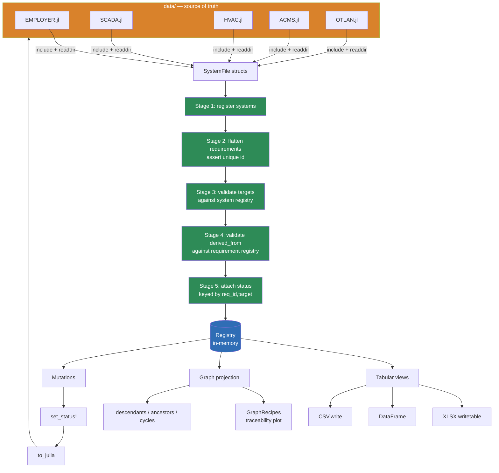

# ReqView.jl

A Julia prototype of the **Requirements View** for the IPOL product model.

## What it does

- Loads one Julia file per system/actor from `data/`.
- Links them into a single `Registry` — the in-memory source of truth.
- Exposes the two Excel-shaped views (`INCOMING`, `OUTGOING`) as tables.
- Builds the traceability graph: derivations, cascades, mutual allocations.
- Exports per-system Excel workbooks with both sheets.

## Design

- **Model** — structs (`Requirement`, `StatusRecord`, `SystemFile`, `Registry`).
- **Views** — `Vector{NamedTuple}`, consumed by DataFrames / XLSX / CSV.
- **Graphs** — built on demand from the registry via `Graphs.jl`.
- **Persistence** — `data/*.jl` are constructor calls; `to_julia` regenerates them.

The five linker stages (see `src/linker.jl`) enforce the invariants from the Requirements View document: 
unique identity, valid targets, valid derivations, status only for live allocations.

## Try it

```bash
julia --project=. -e 'using Pkg; Pkg.instantiate()'
julia --project=. scripts/demo.jl
julia --project=. -e 'using Pkg; Pkg.test()'
```

## Layout

```
src/        library code
data/       one file per system — the authoritative input
scripts/    runnable demos
test/       unit tests
```

## Flow
```
┌──────────────────────────────────────────────────────────────────────┐
│                          PROCESS STARTUP                             │
└──────────────────────────────────────────────────────────────────────┘
                                │
                                ▼
┌──────────────────────────────────────────────────────────────────────┐
│  LOAD                                                                │
│                                                                      │
│   data/                                                              │
│   ├── EMPLOYER.jl   ──►  employer()  ──► SystemFile ──┐              │
│   ├── SCADA.jl      ──►  scada()     ──► SystemFile ──┤              │
│   ├── HVAC.jl       ──►  hvac()      ──► SystemFile ──┤              │
│   ├── ACMS.jl       ──►  acms()      ──► SystemFile ──┤              │
│   └── OTLAN.jl      ──►  otlan()     ──► SystemFile ──┤              │
│                                                       │              │
│   (include() + readdir() — no parser, files ARE code) │              │
└───────────────────────────────────────────────────────┼──────────────┘
                                                        ▼
┌──────────────────────────────────────────────────────────────────────┐
│  LINK  (linker.jl)                                                   │
│                                                                      │
│   ┌──────────────────────────────────────────────────────────┐       │
│   │ 1. register every system.id in reg.systems               │       │
│   │ 2. flatten every Requirement into reg.requirements       │       │
│   │    ── assert id uniqueness across ALL systems            │       │
│   │ 3. for each target ∈ req.targets:                        │       │
│   │    ── assert target ∈ reg.systems                        │       │
│   │ 4. for each parent ∈ req.derived_from:                   │       │
│   │    ── assert parent ∈ reg.requirements                   │       │
│   │ 5. index status records by (req_id, target)              │       │
│   │    ── assert every (req_id,target) is a live allocation  │       │
│   └──────────────────────────────────────────────────────────┘       │
│                                                                      │
│   on failure → LinkError{stage, offending_id, message}               │
└──────────────────────────────────────────────────────────────────────┘
                                │
                                ▼
┌──────────────────────────────────────────────────────────────────────┐
│                    REGISTRY  (in-memory, single truth)               │
│                                                                      │
│   systems      :: Dict{String, SystemFile}                           │
│   requirements :: Dict{String, Requirement}      ← by id             │
│   status       :: Dict{(String,String), StatusRecord} ← (req, target)│
│                                                                      │
│   allocations  — NOT stored; computed as                        │
│                  [(r.id, t) for r in requirements for t in r.targets]│
└──────────────────────────────────────────────────────────────────────┘
                                │
        ┌───────────────────────┼───────────────────────┐
        │                       │                       │
        ▼                       ▼                       ▼
┌──────────────────┐  ┌──────────────────┐  ┌──────────────────────────┐
│  TABULAR VIEWS   │  │   GRAPH VIEW     │  │   MUTATION               │
│  views.jl        │  │   graph.jl       │  │   store.jl               │
│                  │  │                  │  │                          │
│ incoming_view    │  │ build_graph(reg) │  │ set_status!              │
│ outgoing_view    │  │ descendants()    │  │ add_requirement!         │
│                  │  │ ancestors()      │  │ (invariants enforced)    │
│ Returns          │  │ cycles()         │  │                          │
│ Vector{NamedTuple}│ │                  │  │                          │
└────────┬─────────┘  └────────┬─────────┘  └─────────┬────────────────┘
         │                     │                      │
         ▼                     ▼                      ▼
┌──────────────────┐  ┌──────────────────┐  ┌──────────────────────────┐
│ SINKS            │  │ SINK             │  │ WRITE-BACK               │
│                  │  │                  │  │                          │
│ XLSX.writetable  │  │ GraphRecipes     │  │ to_julia(reg)            │
│ CSV.write        │  │ plot_trace()     │  │   → regenerates          │
│ DataFrame(...)   │  │                  │  │     data/*.jl files      │
└──────────────────┘  └──────────────────┘  └──────────────────────────┘
```

## The Linker
```
                SystemFile × N  (one per data/*.jl)
                        │
                        ▼
        ┌───────────────────────────────┐
        │ Stage 1: REGISTER SYSTEMS     │
        │                               │
        │ for f in files:               │
        │   reg.systems[f.id] = f       │
        │ assert no duplicate system.id │
        └───────────────┬───────────────┘
                        │
                        ▼
        ┌───────────────────────────────┐
        │ Stage 2: FLATTEN REQUIREMENTS │
        │                               │
        │ for sys in reg.systems:       │
        │   for r in sys.outgoing:      │
        │     assert r.id ∉ reqs        │ ◄── "one identity, one definition"
        │     assert r.origin == sys.id │
        │     reqs[r.id] = r            │
        └───────────────┬───────────────┘
                        │
                        ▼
        ┌───────────────────────────────┐
        │ Stage 3: VALIDATE TARGETS     │
        │                               │
        │ for r in reqs:                │
        │   for t in r.targets:         │
        │     assert t ∈ reg.systems    │ ◄── rejects unknown target
        │                               │
        │  (allocations ≡ derived here) │
        └───────────────┬───────────────┘
                        │
                        ▼
        ┌───────────────────────────────┐
        │ Stage 4: VALIDATE DERIVATIONS │
        │                               │
        │ for r in reqs:                │
        │   for p in r.derived_from:    │
        │     assert p ∈ reqs           │ ◄── rejects orphan cascade
        │                               │
        │  (cycles are ALLOWED —        │
        │   that's the HVAC↔ACMS case)  │
        └───────────────┬───────────────┘
                        │
                        ▼
        ┌───────────────────────────────┐
        │ Stage 5: ATTACH STATUS        │
        │                               │
        │ for sys in reg.systems:       │
        │   for s in sys.status:        │
        │     key = (s.req_id, s.target)│
        │     assert key ∈ allocations  │ ◄── can't status what you don't own
        │     assert s.target == sys.id │ ◄── status belongs to the TARGET
        │     reg.status[key] = s       │
        │                               │
        │   missing key → NOT_STARTED   │ ◄── default on read
        └───────────────┬───────────────┘
                        │
                        ▼
                    Registry ✓
```

